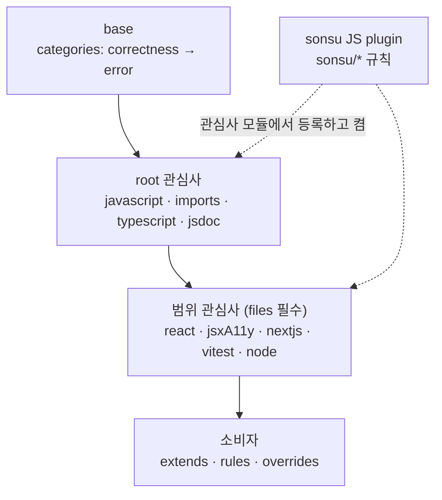

# Lint 패키지 구조

구현 전에 합의한 구조와 작업 순서다. 작업은 [#21](https://github.com/sonsu-lee/oxc-config/issues/21)과 그 하위 이슈로 관리한다. 각 항목이 구현되면 구조는 [설계](design.md), 규칙 기준은 [규칙 결정](rule-ledger.md)에 반영한다. 수치는 Oxlint 1.87.0과 현재 [실효 규칙 표](../test/fixtures/effective-rules.json) 기준이다.

## 1. 원칙

### 출발점

사용하기로 한 플러그인을 켜고 그 플러그인의 `correctness` 규칙을 `error`로 받는 상태를 출발점으로 둔다. Oxlint 기본값(correctness `warn`)과 달리 `error`로 두는 이유는 lint를 CI와 에이전트 작업의 통과 조건으로 쓰기 때문이다. 다른 category(suspicious 포함)는 일괄 상속하지 않고 규칙 하나씩 채택한다.

플러그인은 두 조건을 모두 만족할 때 켠다. 대상 환경이 그 플러그인이 다루는 API나 프레임워크를 쓰고(환경 계약), 검증용 소비자 코드에서 상속되는 correctness 규칙을 실행했을 때 옵션이나 규칙 단위 조정으로 해결되지 않는 오탐이 없어야 한다. 실행 결과는 규칙 변경의 증거와 같은 방식으로 남긴다.

### 변경 이유

출발점에서 벗어나는 변경은 아래 이유 중 하나와 증거가 있어야 한다.

| 이유      | 허용하는 변경                                                     | 증거                                                    |
| --------- | ----------------------------------------------------------------- | ------------------------------------------------------- |
| 오탐 관찰 | 옵션으로 범위를 좁히고, 안 되면 `warn`(강제 수준 조건) 또는 `off` | 정상 코드와 그 진단. `warn`이면 규칙이 잡는 실제 위반도 |
| 누락 관찰 | 옵션 추가                                                         | 기본 옵션에서 통과하는 실제 위반                        |
| 중복      | `off`                                                             | tsc·oxfmt·다른 규칙이 같은 코드를 잡는 결과             |
| 환경 계약 | `off` 또는 추가                                                   | 전제(React 19, ESM, Node 24 등)와 규칙 문서             |
| 결함 관찰 | category 밖 규칙 추가                                             | 사람이나 에이전트가 만든 결함의 재현과 진단             |

다른 공개 설정이 켰다는 사실, 더 엄격해 보인다는 판단, 취향, 템플릿 값은 이유가 아니다. 다른 공개 설정은 검토 후보를 찾는 데만 쓰고 저장소에 기록하지 않는다.

### 강제 수준

채택한 규칙은 `error`가 기본이다. `warn`은 오탐이 관찰됐고, 옵션으로 오탐과 위반을 구분할 수 없으며, 그래도 위반이 결함일 가능성이 높아 신호로 남길 때만 쓴다. 채택하지 않은 규칙은 출발점이므로 이유를 적지 않고, 검토한 뒤 탈락시킨 후보만 사유를 한 줄 남긴다.

소비자 코드에서 `error` 규칙을 disable 주석으로 끌 때는 사유를 남긴다. `error`는 통과 조건이므로, 사유 없는 예외는 리뷰에서 정당한지 판단할 수 없다.

바꾼 규칙의 위반·정상 입력은 `test/fixtures/`에 저장하고 설치 소비자 검사가 다시 실행한다. 입력으로 표현할 수 없는 증거(중복 결과, 환경 계약의 전제와 규칙 문서)는 ledger의 해당 행에 적는다. 입력 형식과 로더는 #22에서 만들고, type-aware 규칙의 재실행은 tsgolint를 설치하는 #25에서 더한다.

현재 조정은 이 기준보다 먼저 내린 결정이다. correctness 규칙을 `warn`으로 내린 것 37개와 `off`로 끈 것 16개, category 밖 규칙 추가 6개(그중 `warn` 4개), 옵션 1개, 상속되지 않는 규칙의 `off` 1개(`react/unsupported-syntax`)다. 해당 관심사의 검수 PR에서 이 기준으로 다시 판단한다.

## 2. 구조

- **base:** category만 가진다. Oxlint는 category를 override에 둘 수 없고 활성 플러그인 전체에 적용하므로 한 곳에서만 선언한다. category만 가진 조각이 다른 조각의 플러그인과 override에서 켠 플러그인에 적용되는 것을 1.85.0에서 확인했다.
- **관심사 모듈:** 관심사 하나에 필요한 플러그인을 켜고, 그 관심사의 규칙 차이만 둔다. 모듈 이름은 현재 공개 export(`javascript`, `imports`, `typescript`, `react`, `jsxA11y`, `nextjs`, `vitest`)를 유지하고 `jsdoc`, `node`를 새로 둔다.
- **규칙 소유:** 규칙 하나의 설정은 한 모듈에만 둔다. 기본 소유자는 규칙을 제공하는 플러그인이 속한 관심사이고, 예외는 아래 지도의 "맡는 core 규칙"에 적는다. 같은 규칙이 두 모듈에 나오는 경우는 파일 범위가 다를 때뿐이다(예: `javascript`가 모든 파일에 켠 core 규칙을 `typescript`가 TS 파일에서만 조정). 실효 규칙 표와 설치 소비자 검사는 지금 규칙 ID마다 값 하나만 저장하므로, 같은 규칙을 파일 범위별로 다르게 두는 첫 이슈가 표 형식과 검사를 범위별 값으로 확장한다.
- **범위:** 소비자가 정하는 파일(프레임워크·테스트)에서만 의미가 있는 관심사는 `files`를 받아 override 하나를 반환한다. 확장자로 정해지는 예외는 그 관심사 모듈의 override에 둔다.
- **factory 옵션:** 소비자만 아는 사실(파일 경로)만 받는다. 규칙 취향은 받지 않고 소비자가 native `rules`·`overrides`로 바꾼다. type-aware와 type-check는 기본으로 켜고, 끄려면 소비자가 native `options`에 `typeAware: false`를 둔다(5절).
- **공개 API:** 기존 export 이름에 `base`를 더한다. 관심사 모듈은 category를 갖지 않으므로, factory 없이 조각을 직접 조합하면 `base`를 함께 넣어야 correctness가 `error`가 된다. 이 변경은 breaking이다. type-aware 기본값(5절)도 별도의 breaking 변경이다.
- **전체 규칙 목록:** `rules:update`가 Oxlint 전체 규칙 목록(ID·category·type-aware)을 `test/fixtures/oxlint-rules.json`에 함께 저장하고 계약 테스트가 설치된 Oxlint와 대조한다. 실효 규칙 표는 켜진 규칙만 담으므로, 업그레이드로 생긴 category 밖 규칙은 이 목록의 diff로 후보가 된다.

## 3. 관심사 지도

| 관심사       | 플러그인                               | 맡는 core 규칙                                                                         | 범위                    |
| ------------ | -------------------------------------- | -------------------------------------------------------------------------------------- | ----------------------- |
| `javascript` | eslint, oxc, unicorn, promise(채택 시) | 아래 예외를 뺀 모든 core 규칙                                                          | 모든 파일               |
| `imports`    | import                                 | import 관련 core 규칙(`sort-imports`, `no-duplicate-imports`, `no-restricted-imports`) | 모든 파일               |
| `typescript` | typescript                             | TS 파일에서의 core 규칙 조정                                                           | 모든 파일 + TS override |
| `jsdoc`      | jsdoc                                  | —                                                                                      | 모든 파일               |
| `react`      | react, react-perf(채택 시)             | —                                                                                      | 소비자 files            |
| `jsxA11y`    | jsx-a11y                               | —                                                                                      | 소비자 files            |
| `nextjs`     | nextjs                                 | —                                                                                      | 소비자 files            |
| `vitest`     | vitest                                 | 테스트 파일에서의 core 규칙 완화                                                       | 소비자 files            |
| `node`       | node                                   | —                                                                                      | 소비자 files(서버 코드) |

promise와 react-perf는 같은 관심사 안의 플러그인으로 넣고, jsdoc과 node는 새 관심사로 둔다. node 규칙은 서버 코드에서만 의미가 있으므로 `files`를 받는다. 아직 켜지 않은 플러그인은 켜는 순간 correctness가 상속되므로 1절의 채택 조건으로 판단한다. `typeAware`·`typeCheck`는 lint 실행 전체에 걸리는 옵션이라 관심사 모듈이 아니라 factory가 설정한다(5절).

| 플러그인   | 관심사       | 켜면 바로 상속되는 correctness |
| ---------- | ------------ | -----------------------------: |
| promise    | `javascript` |                              3 |
| jsdoc      | `jsdoc`      |                              9 |
| node       | `node`       |                              0 |
| react-perf | `react`      |                              0 |

### 현재 상태와 검수 후보

"후보"는 correctness 밖(nursery 제외) 규칙 수다. 검수에서 실제로 보는 규칙은 이 전부가 아니라 6절 검수 절차 1단계의 정의를 따른다.

| 관심사       | 플러그인   | 상속(correctness)           | 현재 조정                                                                               | 후보 (그중 suspicious)      |
| ------------ | ---------- | --------------------------- | --------------------------------------------------------------------------------------- | --------------------------- |
| `javascript` | eslint     | 57                          | `eqeqeq: smart` 추가(error)                                                             | 126 (13)                    |
|              | oxc        | 14                          | —                                                                                       | 13 (4)                      |
|              | unicorn    | 13                          | —                                                                                       | 124 (10)                    |
|              | promise    | 미사용(켜면 3)              | —                                                                                       | 12 (3)                      |
| `imports`    | import     | 2                           | `import/no-duplicates`·`sort-imports` 추가(warn)                                        | 29 (6)                      |
| `typescript` | typescript | 27 (type-aware 15는 미실행) | `no-require-imports` 추가(warn, `ts`·`tsx`·`mts`)                                       | 39 (3) + type-aware 43 (10) |
| `react`      | react      | 31                          | warn 8, off 6, `jsx-key` 옵션, `rules-of-hooks` 추가, `unsupported-syntax` off(상속 밖) | 53 (11)                     |
|              | react-perf | 미사용(켜면 0)              | —                                                                                       | 4 (0)                       |
| `jsxA11y`    | jsx-a11y   | 35                          | warn 15, off 3                                                                          | 1 (0)                       |
| `nextjs`     | nextjs     | 21                          | warn 10, off 3                                                                          | 0                           |
| `vitest`     | vitest     | 17                          | warn 4, off 4, `no-identical-title` 추가(warn)                                          | 56 (1)                      |
| `jsdoc`      | jsdoc      | 미사용(켜면 9)              | —                                                                                       | 14 (0)                      |
| `node`       | node       | 미사용(켜면 0)              | —                                                                                       | 11 (1)                      |

## 4. sonsu 플러그인

직접 만드는 규칙은 Oxlint JS plugin으로 만든다. 외부에서 Rust 규칙을 불러오는 방식은 Oxlint가 제공하지 않는다(확장 경로는 내장 플러그인 기여와 JS plugin). 규칙 엔진 `oxc_linter`도 crates.io에 공개하지 않으므로(`publish = false`) Rust로 만든 규칙은 oxc에 머지하거나 oxlint를 fork해야만 쓸 수 있고, fork는 하지 않는다. 범용 규칙은 Rust로 oxc에 기여하는 것을 먼저 검토한다. 외부에 공개된 JS plugin(ESLint 플러그인)은 고려하지 않는다.

- **형태:** 이 저장소 안에 두고 규칙 ID는 `sonsu/...`로 한다. 규칙마다 구현·테스트·문서를 함께 둔다. 규칙을 쓰는 관심사 모듈이 `jsPlugins`로 등록하고 그 모듈에서 켠다.
- **작성 API:** 규칙은 `createOnce`를 가진 일반 객체로 작성하고 `eslintCompatPlugin`으로 감싸지 않는다. 그 함수는 ESLint용 `create`를 더할 뿐이고, Oxlint는 감싸지 않은 `createOnce` 규칙을 그대로 실행한다. 타입은 `@oxlint/plugins`를 devDependency로 두고 `import type`으로만 가져오며 공개 타입 선언에는 노출하지 않는다. 그래서 런타임 의존성은 생기지 않는다. 이 devDependency는 Oxlint와 같은 번호로 릴리스되므로(1.87.0 존재) Oxlint와 같은 정확한 버전으로 고정하고 함께 올린다.
- **경로:** Oxlint는 `extends`로 받은 조각의 `jsPlugins`에서 상대 경로를 거부하고 패키지 이름이나 절대 경로만 받는다. 그래서 패키지 안 파일의 절대 경로를 넘긴다. 절대 경로와 `import.meta.resolve`가 돌려주는 `file://` URL은 둘 다 동작했다. 구현 때 설치 소비자에서 다시 확인한다.
- **제약:** JS plugin은 alpha이고 semver 대상이 아니다(1.87.0 설정 스키마). 타입 정보가 필요한 규칙과 커스텀 파서는 지원하지 않는다. 검사한 Oxlint 버전 고정과 설치 소비자 검사로 관리한다.
- **포함 기준:** 내장 규칙이나 내장 규칙의 옵션·설정으로 표현할 수 없고, 1절의 이유와 증거가 있는 규칙만 넣는다. 첫 규칙이 정해질 때 플러그인을 만들고, 규칙 없는 플러그인은 만들지 않는다.

경로와 작성 API의 근거는 [JS plugin probe](evidence/type-aware-js-plugin-probes-2026-10-14.json)에 있다.

| 후보                                                            | 관심사       | 근거                                                                                                                                                                                             | 상태      |
| --------------------------------------------------------------- | ------------ | ------------------------------------------------------------------------------------------------------------------------------------------------------------------------------------------------ | --------- |
| disable 주석에 사유 강제 (`sonsu/require-disable-reason`, 가칭) | `javascript` | 1절 강제 수준의 disable 사유 원칙(환경 계약). Oxlint는 disable 주석 뒤 `-- 사유`를 받지만 강제하는 내장 규칙이 없고, `unicorn/no-abusive-eslint-disable`은 규칙을 지정하지 않은 disable만 잡는다 | 채택 후보 |
| formatter ignore 주석 금지                                      | `javascript` | 결함 관찰 필요                                                                                                                                                                                   | 보류      |
| 에이전트가 반복하는 결함 패턴                                   | 해당 관심사  | 결함 관찰 시 추가                                                                                                                                                                                | 관찰 대기 |

같은 효과를 내장 규칙으로 낼 수 있는 것은 sonsu에 넣지 않는다. 예를 들어 `dist`나 `node_modules` 경로 import 금지는 `no-restricted-imports` 패턴(`imports`), top-level await 금지는 `node/no-top-level-await`, 함수 선언 형태는 `func-style`로 처리한다.

### 타입 정보가 필요한 규칙

타입 정보가 필요한 커스텀 규칙은 만들지 않고 upstream 지원을 기다린다. [JS plugin](https://oxc.rs/docs/guide/usage/linter/js-plugins.md)은 type-aware 규칙을 지원하지 않는다. 그런 규칙을 작성할 수 있는 ESLint와 typescript-eslint는 typescript-eslint 8.71.1 기준 `typescript >=4.8.4 <6.1.0`만 지원한다. TypeScript 7.0에는 다른 도구가 쓸 API가 없고 7.1에서 새 API가 나올 예정이며, typescript-eslint는 그 API를 기다린다([typescript-eslint#10940](https://github.com/typescript-eslint/typescript-eslint/issues/10940)).

그런 규칙이 필요해지면 먼저 내장 type-aware 규칙과 그 옵션으로 표현할 수 있는지 본다. 안 되면 Oxlint JS plugin이 타입 정보를 지원하거나 typescript-eslint가 TS 7.1 API를 지원할 때 다시 판단한다. ESLint를 함께 돌리는 경로는 두지 않는다.

## 5. type-aware와 type-check

type-aware 규칙을 사용한다. 확인한 조건은 다음과 같다. 근거는 [type-aware probe](evidence/type-aware-js-plugin-probes-2026-10-14.json)(Oxlint 1.87.0, oxlint-tsgolint 7.0.2004)와 [이전 기록](evidence/starter-verification-2026-09-28.md)이다.

- `options.typeAware`(또는 `--type-aware`)는 `oxlint-tsgolint`가 필요하다. Oxlint 1.87.0은 이를 optional peer `>=7.0.2003`으로 선언한다. 없으면 `Failed to find tsgolint executable`로 lint 전체가 실패한다.
- [Oxc 문서](https://oxc.rs/docs/guide/usage/linter/type-aware)는 type-aware에 TypeScript 7.0 이상을 요구한다. tsgolint는 설치된 TypeScript가 아니라 자체 TS 7 엔진으로 tsconfig와 타입을 검사하므로, 실제로 실패하는 지점은 tsconfig가 TS 7과 호환되지 않을 때다. `baseUrl`이나 `moduleResolution: node`가 있으면 `ignoreDeprecations: "6.0"`을 넣어도 `Invalid tsconfig`로 실패한다. `paths` 값이 상대 경로가 아니면 `typescript(tsconfig-error)`가 났고 `./src/...`로 고치자 해소됐다. TypeScript 6.0.3을 설치한 프로젝트에서도 TS 7과 호환되는 tsconfig면 동작했지만, 이는 관찰일 뿐 upstream 지원 범위가 아니다.
- 켜면 이미 상속된 type-aware correctness 15개(`no-floating-promises`, `await-thenable` 등)가 실행되기 시작하므로 같은 PR에서 정상 패턴으로 판단한다.
- `options.typeCheck`(또는 `--type-check`)는 TypeScript 컴파일러 진단을 lint 결과에 포함한다. Oxlint가 experimental로 표시하고 TS 7 기준이라 프로젝트의 `tsc`와 결과가 다를 수 있다. `typeAware` 없이 켜면 Oxlint가 실행을 거부한다.
- 두 옵션은 `extends`로 받은 조각에 두어도 적용된다. Oxc 문서의 "root config에서만"은 디렉터리별 nested config에서 쓸 수 없다는 뜻이다.

type-check도 기본으로 켠다. lint 한 번으로 타입 오류까지 통과 조건에 넣기 위해서다. 대가로 소비자 CI에서 `tsc`와 같은 오류가 두 번 보고될 수 있고, experimental 기능이라 Oxlint를 올릴 때 진단이 바뀔 수 있다.

구현은 다음과 같다.

- `oxlint-tsgolint`를 oxlint·oxfmt처럼 정확한 버전의 optional peer로 추가하고, 이 저장소의 devDependencies와 설치 소비자 검사의 설치 목록에 넣는다.
- factory가 root `options`에 `typeAware: true`를 두고, `typeCheck`는 소비자가 정하지 않으면 `typeAware` 값을 따른다. 그래서 소비자는 `typeAware: false` 하나로 둘 다 끈다. 나머지는 소비자의 `options`와 합친다. 끄는 경로도 설치 소비자 검사에 넣는다.
- 조각을 직접 조합하는 소비자는 `options`를 직접 넣는다.
- tsgolint가 없거나 tsconfig가 TS 7과 맞지 않으면 lint 전체가 실패하므로 이 변경은 breaking이다.
- README의 설치 명령, Dependencies·Updating 절, "type-aware를 켜지 않는다"는 문구를 고치고 지원 조건(TypeScript 7.0 이상, TS 7과 호환되는 tsconfig)과 끄는 방법을 적는다.

## 6. 작업 순서

이슈 하나는 주제 하나를 맡는다. 큰 이슈는 PR 여러 개로 나눠도 된다.

| 순서 | 이슈                                                                    | 내용                                                                                                                                                                                                      |
| ---- | ----------------------------------------------------------------------- | --------------------------------------------------------------------------------------------------------------------------------------------------------------------------------------------------------- |
| 0    | [#22](https://github.com/sonsu-lee/oxc-config/issues/22) 구조 정비      | 이 문서 머지, `base` 분리, 관심사 모듈의 category 제거, 전체 규칙 목록 스냅샷, 증거 입력 형식과 설치 소비자 검사의 로더, 1절 원칙을 ledger에 반영. 실효 규칙 변경 0건이 통과 조건                         |
| 1    | [#24](https://github.com/sonsu-lee/oxc-config/issues/24) `imports`      | 후보가 적어 검수 절차와 ledger 형식을 먼저 시험                                                                                                                                                           |
| 2    | [#25](https://github.com/sonsu-lee/oxc-config/issues/25) TypeScript     | 5절 구현(breaking), type-aware correctness 15개와 type-check 진단 판단, 이어서 typescript 플러그인 검수(type-aware 후보 포함). TS 파일의 core 규칙 조정은 #27이 맡는다                                    |
| 3    | [#27](https://github.com/sonsu-lee/oxc-config/issues/27) `javascript`   | eslint → oxc → unicorn → promise. oxc가 eslint와 겹치는 규칙(예: `no-bitwise`와 `oxc/bad-bitwise-operator`)은 eslint 결정 뒤에, promise는 1절 채택 조건부터. core 규칙을 바꿀 때 TS 파일 조정도 함께 판단 |
| 4    | [#31](https://github.com/sonsu-lee/oxc-config/issues/31) UI             | `react` → `jsxA11y` → `nextjs`. 기존 warn·off 재판단, `react`에서 react-perf는 1절 채택 조건으로 판단                                                                                                     |
| 5    | [#34](https://github.com/sonsu-lee/oxc-config/issues/34) `vitest`       | 기존 warn·off 재판단                                                                                                                                                                                      |
| 6    | [#35](https://github.com/sonsu-lee/oxc-config/issues/35) 새 관심사      | `jsdoc`(켜면 correctness 9개 상속)과 `node`(새 범위 모듈과 factory `node` 옵션)                                                                                                                           |
| 7    | [#37](https://github.com/sonsu-lee/oxc-config/issues/37) sonsu 플러그인 | 4절 첫 후보. 순서는 다른 이슈와 독립                                                                                                                                                                      |

검수 PR 하나의 절차:

1. 후보를 뽑는다: 기존 조정, 그 플러그인의 suspicious(type-aware 포함), 외부 공개 설정에서 채택된 correctness 밖 규칙, 오탐 신호가 있는 상속 correctness 규칙(외부 공개 설정이 끈 규칙, 소비자 코드나 upstream 이슈에서 관찰된 오탐). 참고한 외부 공개 설정은 PR 설명에만 적는다.
2. 행마다 1절의 이유와 증거로 판정한다. 이유가 없으면 출발점에 둔다.
3. 바꾼 규칙의 위반·정상 입력을 `test/fixtures/`에, 입력으로 표현할 수 없는 증거는 ledger 행에 남긴다.
4. 관심사 모듈, ledger 절, `rules:update` 결과를 함께 커밋하고 `pnpm run verify`를 통과시킨다.

## 7. 정한 결정

- 다른 category는 일괄 상속하지 않고 규칙 하나씩 채택한다.
- 플러그인은 환경 계약이 있고 상속되는 correctness 규칙에 해결되지 않는 오탐이 없을 때 켠다.
- 모듈은 관심사 단위로 나누고 category는 `base` 한 곳에 둔다.
- 바꾼 규칙의 재실행 입력은 `test/fixtures/`에, 그 밖의 증거는 ledger에 둔다.
- 직접 만드는 규칙은 저장소 안의 sonsu JS plugin으로 만들고, `@oxlint/plugins`는 타입 전용 devDependency로 쓴다. 외부 JS plugin은 고려하지 않는다.
- 소비자 코드에서 `error` 규칙을 disable 주석으로 끌 때는 사유를 남긴다.
- type-aware와 type-check를 기본으로 켜고 breaking으로 릴리스한다. `oxlint-tsgolint`는 optional peer이고, `typeAware: false` 하나로 둘 다 끈다.
- jsdoc과 node는 새 관심사로 둔다.
- 타입 정보가 필요한 커스텀 규칙은 upstream 지원을 기다린다.
- type-aware 지원 조건은 upstream 기준인 TypeScript 7.0 이상이다. 실제로 실패하는 지점은 tsconfig가 TS 7과 호환되지 않을 때다.
